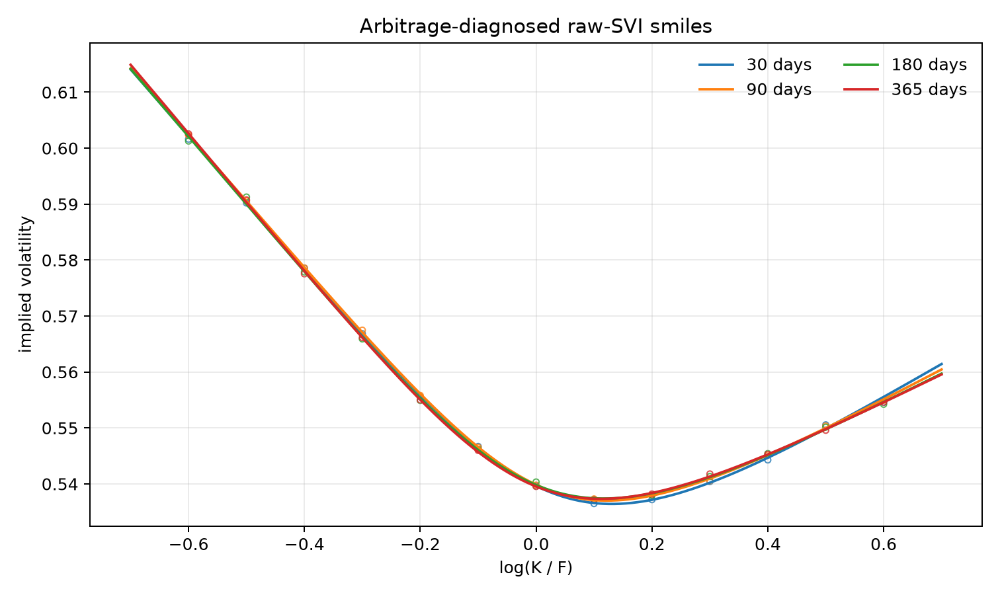
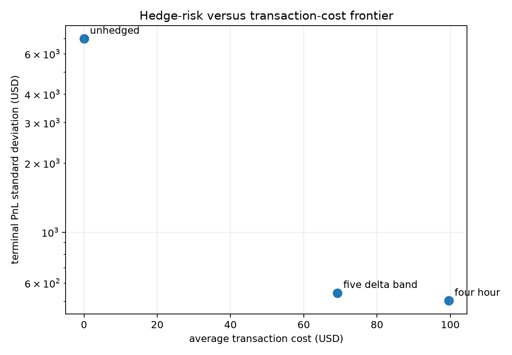

# Crypto Options Pricing, Volatility Surface & Dynamic Hedging Engine

An auditable research engine for crypto European options. It cleans two-sided option chains,
inverts Black-76 implied volatility with explicit price bounds, calibrates raw-SVI in total-
variance space, diagnoses static arbitrage, and simulates self-financing delta hedging with a
fully reconcilable event ledger.

This is deliberately more than a Black-Scholes notebook. The implementation makes invalid
quotes, model assumptions, transaction costs, and hedging residuals visible instead of hiding
them behind a chart or a single backtest statistic.

> **Scope:** research and model-validation software, not trading advice or a production execution
> system. Checked-in results are synthetic benchmarks with known data-generating assumptions.

## Why the implementation is not naive

- **Bounded IV inversion:** rejects premiums outside discounted intrinsic/upper bounds, handles
  zero-volatility and infinite-volatility boundaries explicitly, and uses a bracketed root solver.
- **Quote hygiene:** requires genuine two-sided markets; crossed, stale-like, overly wide, expired,
  and negligible-vega observations receive audit reasons rather than mark-price substitution.
- **Total-variance SVI:** fits `w(k) = sigma_BS(k, T)^2 T`, uses liquidity/IV-spread weights and
  robust loss, and applies soft penalties for negative variance, Lee wing slopes, butterfly
  density, and calendar spread.
- **Post-fit safety gate:** independently checks Gatheral-Jacquier `g(k)` and calendar monotonicity
  on a disclosed log-moneyness grid; strict mode refuses a failing surface.
- **Self-financing hedging:** option premium, spot hedge, bid/ask execution, fees, cash interest,
  underlying carry, expiry settlement, and hedge close-out all flow through one cash account.
- **Structured payoff:** a stablecoin Dual-Currency Investment has explicit settlement-currency
  switching, fair-coupon solving, and price/Greeks through its cash-minus-short-put replication.
- **PnL identity:** every run reconciles terminal PnL to delta, gamma, vega, theta, higher-order
  residual, hedge PnL, financing, and transaction costs.
- **Fair policy comparison:** every hedge policy receives the same seeded stochastic spot/vol path.

## Architecture

```text
Deribit REST / synthetic chain
             |
             v
 two-sided quote validation -----> rejection audit
             |
             v
 bounded Black-76 IV inversion
             |
             v
 weighted raw-SVI calibration ----> butterfly/calendar diagnostics
             |                                  |
             +------------------------ strict safety gate

 market event -> option mark/Greeks -> hedge policy -> execution/cash account
       |                                                    |
       +-------------------- PnL attribution <--------------+
```

## Quick start

Requires Python 3.11+.

```bash
git clone https://github.com/OwenWang19/Crypto-Options-Pricing-Volatility-Surface-Dynamic-Hedging-Engine.git
cd Crypto-Options-Pricing-Volatility-Surface-Dynamic-Hedging-Engine
python -m venv .venv
source .venv/bin/activate
python -m pip install -e ".[dev]"
make check
python -m crypto_options.cli demo --out-dir artifacts/reference --paths 250 --steps 180 --seed 17
```

Price and invert a premium directly:

```bash
crypto-options price --forward 60000 --strike 60000 --maturity 0.25 \
  --volatility 0.60 --rate 0.03 --option-type call

crypto-options implied-vol --premium 7100.6678689251 --forward 60000 \
  --strike 60000 --maturity 0.25 --rate 0.03 --option-type call
```

## Seeded reference experiment

The checked-in run uses seed 17, 250 common stochastic-volatility paths, a 30-day short BTC call,
180 four-hour events per path, 1 bp hedge half-spread, and 2 bp hedge fee. Results measure hedge
risk and cost under the simulator; they do **not** represent historical or expected trading profit.

| Policy | Mean PnL | PnL stdev | 5% expected shortfall | Avg. costs | Avg. trades | Stdev reduction |
| --- | ---: | ---: | ---: | ---: | ---: | ---: |
| Unhedged | -$495.01 | $6,989.00 | -$20,852.13 | $0.00 | 0.0 | 0.0% |
| Four-hour | -$137.74 | $502.61 | -$1,348.04 | $99.57 | 164.1 | 92.8% |
| Five-delta band | -$105.77 | $543.53 | -$1,364.30 | $69.20 | 36.8 | 92.2% |

The useful result is the cost-risk trade-off: four-hour hedging had the lowest dispersion, while
the delta-band policy retained most of that reduction with 78% fewer hedge trades. No strategy is
declared "best" without specifying an execution-cost and tail-risk objective.

The surface benchmark accepted 102 of 104 quotes, fitted market IV with **3.58 vol-bp RMSE**, and
recorded zero butterfly/calendar violations on the documented 401-point diagnostic grid.





## Public Deribit snapshot adapter

No credentials are required for public market data:

```bash
crypto-options fetch-deribit --currency BTC --output artifacts/deribit_btc.csv
```

The adapter joins [`public/get_instruments`](https://docs.deribit.com/api-reference/market-data/public-get_instruments),
[`public/get_book_summary_by_currency`](https://docs.deribit.com/api-reference/market-data/public-get_book_summary_by_currency),
and [`public/get_index_price`](https://docs.deribit.com/api-reference/upcoming/market-data/public-get_index_price).
BTC/ETH inverse option premiums are quoted in base currency; the adapter follows Deribit's
convention by multiplying premiums by the spot index for USD-equivalent prices while retaining the
expiry forward for IV. The raw snapshot timestamp and all cleaning rejections remain explicit.
Polling is for research snapshots; Deribit recommends WebSocket subscriptions for real-time systems.

## Validation

```bash
make test       # numerical, property-style, accounting, adapter, and integration tests
make lint       # Ruff formatting and static checks
make check      # both
```

The test suite covers:

- put-call parity and Black-76/IV round trips across moneyness and volatility regimes;
- analytic delta/gamma/vega/volga versus central differences;
- SVI first/second derivatives, synthetic recovery, and static-arbitrage diagnostics;
- quote rejection and robust put-call-parity forward recovery;
- Deribit metadata/summary joining and inverse-premium conversion;
- event ordering, exact-expiry settlement, transaction-cost impact, seeded paths, and PnL
  reconciliation;
- end-to-end artifact generation from a clean environment.

## Repository layout

```text
src/crypto_options/
  pricing/black76.py        # price, Greeks, bounds, implied-vol inversion
  marketdata/chain.py       # chain cleaning, weights, parity forwards
  marketdata/deribit.py     # retrying public snapshot adapter
  surface/svi.py            # raw-SVI fit, interpolation, safety diagnostics
  products/dual_currency.py # stablecoin DCI replication, settlement, Greeks
  hedging/simulator.py      # self-financing event loop and PnL attribution
  hedging/paths.py          # correlated spot/log-vol scenario generator
  research/                 # reproducible benchmark and artifact production
tests/                      # unit, numerical, accounting, and integration checks
docs/methodology.md         # equations, event order, assumptions, limitations
artifacts/reference/        # checked-in seeded outputs and ledgers
```

## What this project does not claim

- The synthetic benchmark is not a historical backtest and contains no alpha claim.
- SVI penalties and grid diagnostics reduce detected static arbitrage; they are not a proof over
  every real number or a replacement for production surface governance.
- The hedge simulator uses a spot hedge. Perpetual funding, margin, liquidation, exchange outages,
  and order-book impact require separate models before live use.
- A two-request REST snapshot is not atomic and is not suitable for latency-sensitive trading.
- Black-76 is a quoting/risk convention; it does not capture crypto jumps, stochastic rates,
  discrete settlement effects, or smile dynamics by itself.

See [methodology](docs/methodology.md) for equations and [model validation](docs/model_validation.md)
for control objectives and failure-mode tests.
