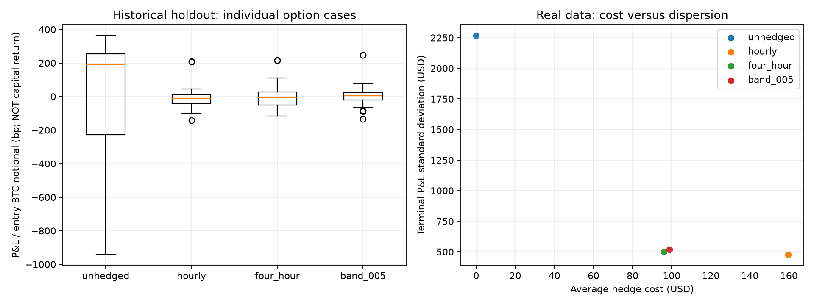

# Historical Backtest: Results and Model Risk

### Scope and data

This upgrade adds an actual historical quote-based backtest, not just a simulated BTC path.
The data comprise 4,498,832 recorded Deribit BTC option snapshots from January–July 2024,
official Binance BTCUSDT minute spot prices and official Deribit delivery prices. The option
panel is a third-party recording linked by Deribit Insights, not exchange-audited data.
Market observations are historical; executions, funding availability and market impact remain
assumptions. No live-profit or guaranteed-fill claim is made.

### Experiment

Each Friday, information already recorded by 09:00 UTC selects the next Friday's near-ATM call
and put. Entry uses the next recorded bid with an additional adverse premium haircut. The spot
hedge executes at a strictly later minute OPEN with fees and slippage; it never uses that minute's
future close. BTC option premiums, conversion costs and official BTC settlement liabilities are
accounted for explicitly. USD/USDT parity and timely cross-venue funding are assumptions.

There are 54 individual option cases across 27 entry weeks, not millions of strategy trades or
54 independent weeks. Thirteen earlier weeks select the band; fourteen later weeks evaluate it.
Selection minimizes normalized terminal-PnL RMSE on calibration data only and chooses 0.05 BTC.
This is retrospective temporal validation, not an independently registered blind trial.

### Findings

| Policy | Mean PnL per case (USD) | PnL standard deviation (USD) | Mean hedge cost (USD) | Mean hedge trades |
| --- | ---: | ---: | ---: | ---: |
| Unhedged | -55.23 | 2,267.11 | 0.00 | 0.00 |
| Hourly | -39.77 | 478.40 | 159.63 | 152.00 |
| Four-hour | 34.16 | 500.04 | 95.97 | 40.71 |
| Selected 0.05 BTC band | 75.26 | 519.97 | 98.90 | 21.89 |

On the 28-case holdout, the selected band reduces entry-notional-normalized terminal PnL standard
deviation by approximately 77.7% versus no hedging. Relative to hourly hedging it uses 85.6% fewer
hedge trades and 38.0% lower hedge costs, with higher residual dispersion. A paired weekly-block
bootstrap does not establish lower risk than hourly hedging. Fourteen weeks remain a small sample.

Average baseline terminal PnL is $75.26 per selected-band case, but increases in assumed trading
costs turn that mean negative: -$25.59 under higher spot costs and -$309.14 under stress costs.
This supports a cost-risk trade-off, not stable profitability. No capital-return or annualized
Sharpe metric is invented without a collateral and margin model.

### Surface model risk

The historical SVI validation is separate from hedging. The first all-quote calibration produced
10 grid-safe, 6 unsafe and 11 non-converged weekly surfaces. Its outputs are preserved. A later,
explicitly post-diagnostic OTM/vega refinement produced 12 grid-safe, 6 unsafe and 9 non-converged
surfaces. The safe-date median held-out IV RMSE is 35.27 vol-bp; pooled RMSE on 466 held-out
observations from those 12 safe dates is 41.04 vol-bp. These are conditional statistics, not
full-sample performance. The synthetic 3.58 vol-bp result must not be relabelled historical.

### Reliability and limitations

Ninety-three tests pass with approximately 91.6% coverage and warnings treated as errors.
An independent verifier checks data/source hashes, timing, pairing, inverse payoff units,
economic PnL and serialized cash flows. All 324 baseline ledgers reconcile within 1e-7 USD.
Non-converged fits, unsafe surfaces, missing quotes and stale delta episodes remain in the audit.

However, hourly L1 snapshots contain no available size or exchange quote-update timestamps.
Minute OPEN prices are execution proxies, not verified executable books. The experiment omits
L2 impact, collateral constraints, liquidation, verified borrow availability and transfer delays.
Consequently, it is a transparent historical research backtest—not proof of feasible live trading.

### Reproducibility and evidence

See the [methodology](../../docs/historical_methodology.md) and
[protocol](../../docs/historical_protocol.md) for selection, timing and accounting rules.
Public evidence includes [policy summaries](policy_summary.csv), [case results](case_results.csv),
[bootstrap intervals](bootstrap.json), [SVI diagnostics](real_svi_validation.csv),
[data audit](data_audit.json), [run manifest](run_manifest.json),
[verification](verification.json) and [repeat-run checks](reproduction.json).

Raw data and the quote-level event ledger are intentionally not redistributed in Git. Their
checksums are retained, and the full ledger is regenerated locally by the backtest. The
independent verifier requires that local run; it is not a raw-data-free checkout test.

```bash
python -m pip install -e ".[dev,historical]"
crypto-options download-historical
MPLCONFIGDIR=/tmp/crypto-options-mpl crypto-options backtest-historical
python scripts/verify_historical.py
python -m pytest -W error --cov=crypto_options --cov-fail-under=85
```

The second offline hedge replay produced byte-identical case results, policy statistics,
compressed ledgers and figure. The second check did not repeat the expensive SVI calibration.



## 中文附录

完整事件账本在本地生成，不随公开仓库分发；公开的是汇总结果、诊断与校验值。

### 1. 结论先说

本项目已不再只有模拟数据：新增真实期权报价、真实现货价格和官方交割价上的历史回放。
但成交仍是带有成本和延迟假设的模拟成交，不是审计实盘收益，也不是完整盘口执行回放。

主要结论是**对冲频率与成本的权衡**，而不是找到稳定盈利策略。真实数据没有复现合成
实验里的 92.2% 数字，真实曲面也没有复现“全样本无套利”或 3.58 vol-bp 精度。

### 2. 数据来源与范围

- 期权：Cryptarbitrage 录制并由 [Deribit Insights 文章](https://insights.deribit.com/education/option-backtest-selling-weekend-vol/)
  链接的 BTC 期权小时面板。2024-01-13 19:00:14 至 2024-07-27 20:00:10 UTC；
  **4,498,832 行、14,332 个合约、209 个到期日**。这是第三方录制，不是交易所审计数据。
- 对冲：Binance 官方 BTCUSDT 分钟开盘价格，2024 年 1—7 月，七份月度 ZIP，校验官方 SHA-256。
- 结算：Deribit 官方 BTC/USD 交割价 API，分页取得 2024-01-01 至 2024-08-01 共 214 个日交割价。
- 完整数据不是 449 万笔策略交易。真正的预设回测样本是 **27 周、54 个期权案例**，每周 call、put 各一份。
- 期权原始文件约 57 MB；数据文件留在本地 `data/raw/`，不假定公开链接等于可再分发许可证。

### 3. 怎样选约和执行

每周五 09:00 UTC，用此前已经记录的数据选择下一周五 08:00 UTC 到期、最接近远期价格
的 call 和 put。要求正的双边报价、正持仓量、相对价差不超过 25%。选定后不能看到后面的
价格再换约。等待下一份快照，用其 bid 再扣额外 1% 权利金滑点假设卖出一份。

对冲 delta 来自已记录的期权中间价隐含波动率。现货腿在严格更晚的下一整分钟，以该分钟
OPEN 加费用与不利滑点作为执行代理，**不用该分钟尚未发生的收盘价**。原始期权快照没有
可成交数量、盘口深度、交易所更新时刻，所以不能保证当时真的能成交一份。

期权权利金以 BTC 报价。账本显式转换收到的 BTC 权利金，按官方交割价计算 BTC 到期负债，
再用独立的到期现货价格换算。现货价格不能代替官方交割 TWAP。借款、借币可得性及跨场所
资金及时可用是研究假设，不能把这个账本冒充真实保证金账户。

### 4. 时间切分与参数

- 校准期：2024-01-19 至 2024-04-12 的 13 个入场周，26 个案例，最晚 4 月 19 日 08:00 结算。
- 检验期：2024-04-19 至 2024-07-19 的 14 个入场周，28 个案例，最晚 7 月 26 日结算。
- 比较：不对冲、每小时、四小时、0.02/0.05/0.10 BTC delta-band。
- 按校准期“终值损益除以入场 BTC 名义金额”的 RMSE 选出 **0.05 BTC**，之后冻结。
  校准期 0.05 与 0.02 的分数很接近，不能说 0.05 是普遍最优阈值。
- 这是事后开展研究时固定的时间分割，不是外部注册的盲测。费用和延迟敏感性是诊断，不是
  在检验期重新选最漂亮的参数。

### 5. 基准检验期结果

单位为每个单独期权案例的美元损益；同周的 call 和 put 并不统计独立。

| 对冲规则 | 平均终值损益 USD | 终值损益标准差 USD | 平均现货对冲成本 USD | 平均对冲交易次数 |
| --- | ---: | ---: | ---: | ---: |
| 不对冲 | -55.23 | 2,267.11 | 0.00 | 0.00 |
| 每小时 | -39.77 | 478.40 | 159.63 | 152.00 |
| 四小时 | 34.16 | 500.04 | 95.97 | 40.71 |
| 选中的 0.05 BTC band | 75.26 | 519.97 | 98.90 | 21.89 |

把每例损益按入场 BTC 名义金额归一化后，band 相对不对冲的标准差下降约 **77.7%**；
相对每小时对冲，交易次数少约 **85.6%**，现货对冲成本少约 **38.0%**，但残余分散度更高。
这些归一化数值不是资本收益率。

每周配对区块 bootstrap（5,000 次）给出的标准差下降区间约 **64.8%—89.9%**。
band 相对每小时对冲的归一化标准差差值区间为 **-1.70 至 +10.13 bp**，包含零，
不能证明其风险低于每小时对冲。只有 14 个检验周，且区块间仍可能存在序列相关。

### 6. 成本与延迟敏感性：盈利不稳健

基准现货每次 5 bp 手续费加 1 bp 不利滑点；期权费按每份 `min(0.0003 BTC, 12.5% 权利金)`
建模，另有明确的交割费及权利金转换成本。这些是研究假设，不是完整的历史客户费率档案。

| 选中 band 的检验期情景 | 平均每例终值损益 USD |
| --- | ---: |
| 基准 | 75.26 |
| 现货费用 10 bp 加滑点 2 bp | -25.59 |
| 现货费用 20 bp 加滑点 5 bp，期权额外滑点 5% | -309.14 |
| 执行延迟改为 2 分钟 | 64.66 |
| 执行延迟改为 5 分钟 | 65.93 |
| 年化借款和借币成本假设 5% | 45.45 |
| 年化借款和借币成本假设 10% | 15.63 |

所以不能把基准均值当成稳定 alpha。所有策略在相同选约集合上比较，没有因为某个情景亏损就删掉案例。

### 7. 真实 SVI 验证：保留失败，不冒充全样本成功

初次使用全部合格 call/put 的实验：27 个周快照中 10 个通过网格检查、6 个未通过、11 个
优化未收敛。完整 CSV 留在 `svi_all_quotes_baseline/`。

随后针对深度实值报价的时间价值精度问题，改用按远期价确定的虚值 call/put，并提高最小
归一化 vega 门槛。这是观察诊断后的建模修订，不是先验注册结论，也不改变历史对冲结果。

最终 27 个快照中：**12 个通过网格检查，6 个未通过，9 个优化未收敛**。通过的日期上，
留出执行价的 IV RMSE 中位数约 **35.27 vol-bp**；仅在这 12 个日期的 466 个留出报价上
汇总 RMSE 约 **41.04 vol-bp**。这是带成功条件的统计，不能代表全部 27 个日期。

call 和 put 的相同执行价被放在同一个数据分组，避免训练和验证互相泄漏。失败和不安全曲面
不会被当作可用定价曲面。**历史对冲使用观察到的中间价 IV，不使用这组 SVI 曲面**。
下一步应改善曲面约束优化的数值稳健性，而不是把未收敛或微小套利违反改名为成功。

### 8. 数据质量、核对和测试

- 原始 bid 缺失 561,115 行，ask 缺失 423,417 行；数据审计不隐藏缺失。面板缺两个小时。
- 已入场案例后来缺双边报价时，冻结上次 delta；超过 2 小时后停止再平衡。中间估值可采用
  已观察的交易所 mark，但 mark 不能变成成交价。所有冻结及陈旧次数均在案例和事件表中。
- 每个终值损益都与“收到的权利金 - 结算负债 - 所有费用 + 对冲损益 + 融资”核对。
- 第二道核对从每一行序列化现金流独立重建现金余额。独立验证器核对了 **2,268 个
  案例/规则/情景结果、54,420 行基准事件、324 个账本**，核对误差在 1e-7 USD 以下。
- **93 个测试通过，覆盖率约 91.6%，警告视为错误运行通过**。测试包含未来数据扰动不改变
  过去决策、币本位单位、官方交割和现货区分、缺数据不插值、校准期选参与检验期隔离。

### 9. 不能声称什么

不能声称生产可用、历史确定成交、精确冲击、真实保证金回报、年化 Sharpe、风险免费或稳定盈利。
没有借币可得性、强平、跨场所转账延迟、历史 USDT 脱锚和盘口深度模型。资金需能及时到位；
这是简化假设，不是已验证事实。每小时估值还会漏掉盘中最坏回撤，半年样本也不足以衡量极端尾险。

### 10. 复现与证据文件

```bash
python -m pip install -e ".[dev,historical]"
crypto-options download-historical
MPLCONFIGDIR=/tmp/crypto-options-mpl crypto-options backtest-historical
python scripts/verify_historical.py
python -m pytest -W error --cov=crypto_options --cov-fail-under=85
```

精确的本地 Python 3.12 依赖见 `requirements-historical-py312.lock`。下载与回测分离，原始数据
已存在时可离线重跑。`run_manifest.json` 包含 9 份数据文件和 21 份源码的 SHA-256、费用参数、
依赖版本和样本边界。`verification.json` 保存独立核对结果。

另一次从原始文件开始的离线对冲重跑，案例结果、策略汇总、压缩事件账本和结果图四份文件的
SHA-256 均逐字节一致，见 `reproduction.json`。这次重复检查没有重跑昂贵的 SVI 校准。

主要证据：`opportunities.csv`、`case_results.csv`、`policy_summary.csv`、`event_ledger.csv.gz`、
`bootstrap.json`、`real_svi_validation.csv`、`real_svi_residuals.csv`、`real_svi_rejections.csv`。


